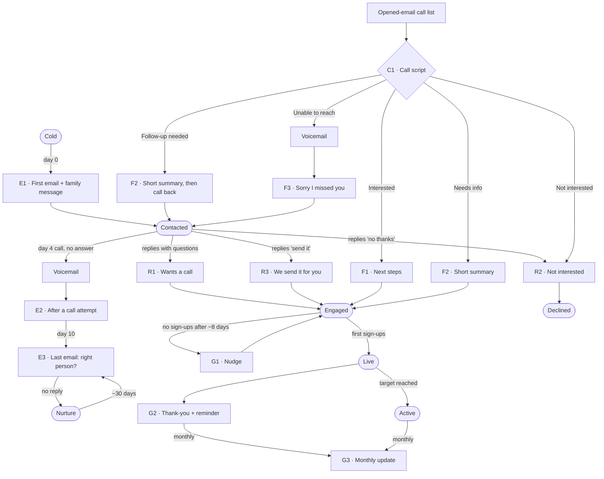

# Email Flow: Missouri school outreach

One lead = one principal = one school. Success = family sign-ups on the school's code.
Each template has its own note in this folder, and **each subfolder is a category** in the Outreach Manager's email dropdown (0 District overseers, 1 Outreach, 2 Replies, 3 After the call, 4 Sign-up support, Calls, Family-facing). Edit, add, move or delete notes here (they live in the Lead Manager project's `emails/` folder; the vault's `Emails/` is a shortcut to it), then reload the app. `npm run dev` and `npm run emails:watch` sync on save; otherwise run `npm run sync-emails` first. The app's **Emails** tab shows every note here. A new note needs a `template_id` in its frontmatter and a ```text block under `## Body` (or `## Script`).

## The flow



## Every template at a glance

| Code | Template | Sent when | Stage after |
|---|---|---|---|
| D1 | [[D1 · District cold intro]] | Day 0, district overseers (Overseers list) | Contacted |
| D3 | [[D3 · Overseer voicemail follow-up - school sign-up links]] | Overseer call not answered, right after the voicemail | Contacted |
| D4 | [[D4 · Overseer replied - school links + family message]] | Overseer replied or said yes on the call | Engaged (marks shared; Live once a district school has sign-ups) |
| E1 | [[E1 · First email + family message (day 0)]] | Day 0, new lead | Contacted |
| E1C | [[E1C · Cold intro - offer + call request (day 0)]] | Day 0, principals who haven't had Mike Nutter's email (Torino's list of 28) | Contacted |
| E2 | [[E2 · After a call attempt (day 4)]] | Day 4, call not answered | Contacted |
| E3 | [[E3 · Last email - right person (day 10)]] | Day 10; Nurture retry | Contacted |
| R1 | [[R1 · Has questions or wants a call]] | Reply with questions | Engaged |
| R2 | [[R2 · Not interested]] | Says no | Declined |
| R3 | [[R3 · Exception - we send it for you]] | Replies "send it" | Engaged |
| C1 | [[C1 · Call script - principal opened the email]] | Opened-email call list | (by outcome) |
| C2 | [[C2 · Front office script - relay a message to the principal]] | Receptionist answers instead of the principal | (no change; log "Front office message") |
| VM | [[Voicemail script (~20 s)]] | Any unanswered call | — |
| F1 | [[F1 · Interested - next steps]] | Call: Interested | Engaged |
| F2 | [[F2 · Needs info or not ready - short summary]] | Call: Needs info / Follow-up | Engaged / Contacted |
| F3 | [[F3 · Unable to reach - after voicemail]] | Call: Unable to reach | Contacted |
| G1 | [[G1 · No sign-ups yet (nudge)]] | Engaged, no sign-ups ~8 days | — |
| G2 | [[G2 · First sign-ups - thank-you + reminder]] | First sign-ups (Live) | — |
| G3 | [[G3 · Monthly update]] | Monthly, Live/Active | — |
| P1 | [[P1 · Family message (forwarded by the school)]] | Inside E1 and F1 | — |
| N1 | [[N1 · Newsletter blurb (~50 words)]] | Inside G1, G2, G3 | — |
| N2 | [[N2 · Text or announcement (short)]] | On request | — |

## Delivery rule (Torino)

Never ask the principal to choose who sends. Delivery is already decided: **default = the school forwards the family message; fallback = they hand us a PTA or parent contact and we send it.** Every email states this as a done deal ("Either way, your families get it").

## Open items before these go out

- [ ] Get Torino's approved wording on how parent contacts are used and stored. It blocks R3 and the "we send it" fallback in E1, E2, F1, F3, C1 and the voicemail 📅 2026-10-09 #outcome/02
- [ ] Ask Torino to confirm the parent privacy line in P1 ("doesn't read your child's private messages or store their passwords"), which may conflict with the Partner Sales Guide's keyboard description 📅 2026-10-09 #outcome/02
- [ ] Confirm the collaboration is CyberSafely.ai + MSBA (not the Foundation), and whether the free year has an end date (E3) 📅 2026-10-09 #outcome/02
- [ ] Update the Outreach Manager after approval: paste the new subjects/bodies, and change the "Interested" next-step label ("who sends to families?") to "Send next steps (F1)" #outcome/02
- [ ] Add the real CyberSafely.ai mailing address to E1 #outcome/02
- [ ] Confirm the product claims in E1, F2, P1, N1, N2 (approved-claims list is still UNAPPROVED) #outcome/02
- [ ] Decide whether E2 and F3 (both "no answer → voicemail → email") should merge #outcome/02

## Merge fields

`{{greeting}}` principal's name · `{{school}}` · `{{sender}}` · `{{phone}}` · `{{signup_link}}` school's code link · `{{onboarding_page}}` · `{{support}}` · `{{signups}}` verified count · `{{parent_email}}` = P1 · `{{newsletter}}` = N1

Older draft: [[Templates/Email/Outreach email 1]] (superseded by E1).

## claims-guard review · 2026-10-08 (refined copy)

Verdict: **FAIL until approved.** No PII, no pricing issues, no Foundation mentions. The blocks are approvals, not rewrites:

| # | Where | Issue | Status |
|---|---|---|---|
| 1 | P1 | Privacy line to parents may conflict with the Partner Sales Guide | Ask Torino |
| 2 | E1, E2, E3, F3, C1, VM | "We'll send it ourselves" depends on the data-handling wording | Ask Torino (company's own Outreach email 2 offers this path) |
| 3 | R3 | Sending as the school; turnaround and "landed" confirmation are commitments | Ask Torino; fill in [X] only if you can keep it |
| 4 | P1, N1, E1, F2 | Detection list + "before it escalates" are unapproved (company wording) | Needs approval |
| 5 | P1 | Collaboration entity unconfirmed | Ask Torino |
| 6 | E1, F2, P1 | Free year / "no cost" offer wording not on the approved list | Needs approval |
| 7 | N1, N2 | "Alerts you early" / "flags online trouble early" | Needs approval |
| 8 | E3 | "Still waiting" implies no deadline | Ask Torino |
| 9–10 | E1, E3 | "Easiest yes on your desk", "a contact sport": flagged as pushy/flippant | Your call: wit was intended |
| 11 | P1 | "Grooming, sextortion" may read as fear-leaning to parents | Your call: it's the company's wording |
